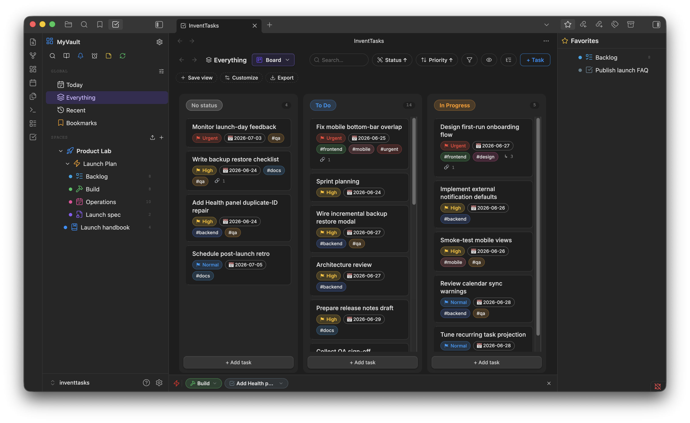
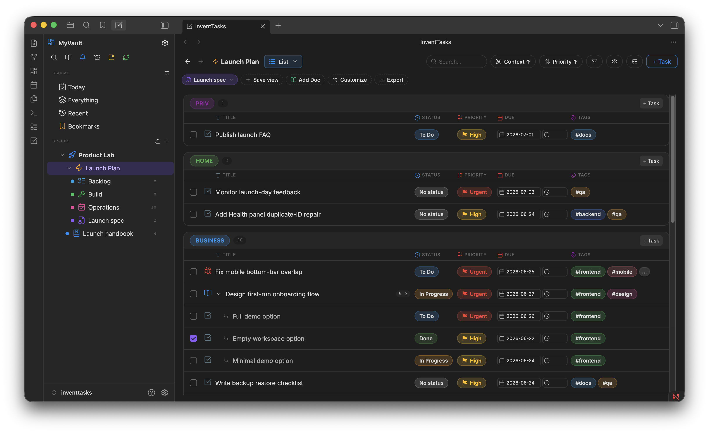
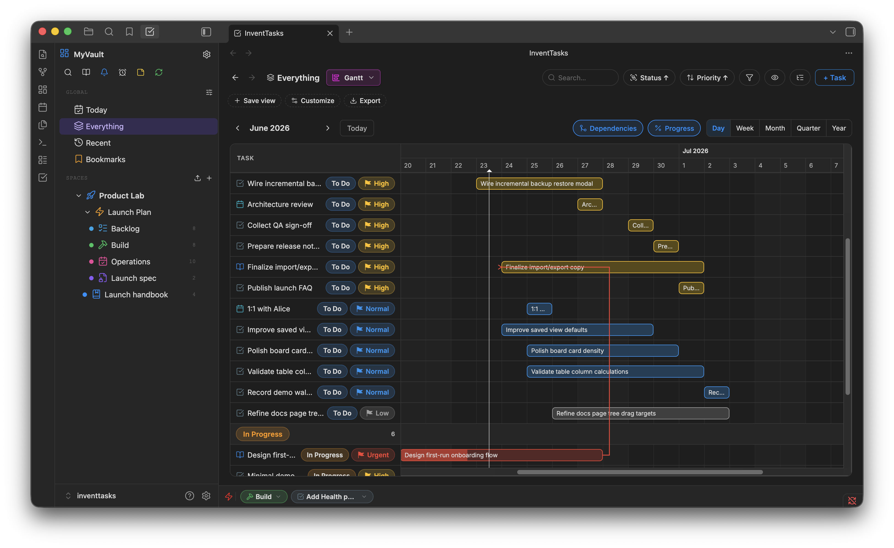
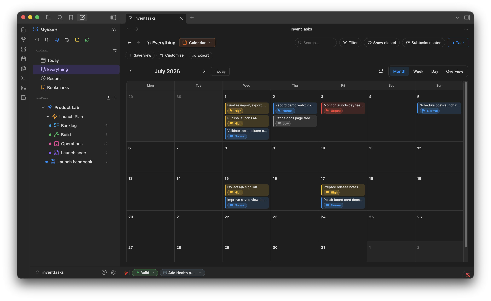
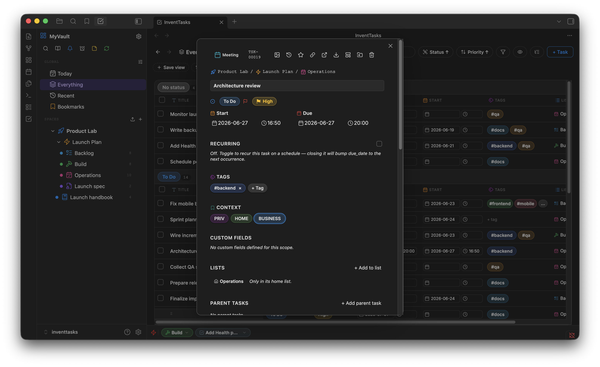
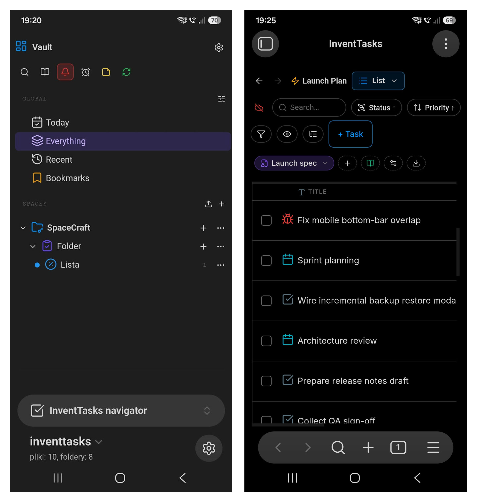

# InventTasks

Project and task management inside [Obsidian](https://obsidian.md) — boards,
lists, custom fields, dependencies and an optional self-hosted sync server.
Everything lives in your vault as plain Markdown files.

**Website and documentation: https://inventtasks.solidinvent.pl**

| List | Gantt |
| --- | --- |
|  |  |
| **Calendar** | **Item** |
|  |  |

This repository holds the plugin's source code and its releases. **InventTasks
is source-available, not open source**: you can read the code, audit what it
does and build it for your own use, under the [EULA](LICENSE). Each release
adds one commit with the source it was built from. The same plugin files are
also available directly from the website.

Building from source: `npm ci && npm run build` produces `main.js`.

## Install

### Manual

1. Download `inventtasks.zip` from the [latest release](https://github.com/solidinvent-dev/inventtasks/releases/latest).
2. Unzip it into `<vault>/.obsidian/plugins/` — the archive contains the
   `inventtasks/` folder.
3. Restart Obsidian, then enable **InventTasks** under
   Settings → Community plugins.

Installing on mobile? `INSTALL.md` inside the zip covers it.

### With BRAT

[BRAT](https://github.com/TfTHacker/obsidian42-brat) installs the plugin from
this repository and keeps it updated automatically:

1. Install BRAT from Obsidian's community plugins.
2. *Add beta plugin* → `solidinvent-dev/inventtasks`.

Each release also carries `main.js`, `manifest.json` and `styles.css` as loose
files, which is what BRAT reads.

## Versions

Every release is tagged and stays available, so you can roll back. The
[latest release](https://github.com/solidinvent-dev/inventtasks/releases/latest)
is always the current version.

## Free, or one lifetime license

- **Free** — every feature and view works, within capacity limits (one
  Space, five Lists, fifty open tasks).
- **Lifetime license** — one payment lifts the limits for good. No
  subscription, no renewals.

Prices are on the website.

## Disclosures

- **Payment.** Full capacity requires a lifetime license (one payment, sold
  through Paddle). No account is needed: a license is an email address and a
  key, checked on your device.
- **Network use.** Without a license and without anything configured, the
  plugin makes no network requests. Each connection below happens only in the
  situation described:
  - **License standing check** — once a day, only after a license is
    activated, the plugin asks SolidInvent's license endpoint whether the
    license is still valid. It sends the license email encrypted to
    SolidInvent's key and a proof derived from the key, never the key itself
    and never vault content. This is how a refunded or leaked license is
    revoked. Being offline never suspends a license: when you are back
    online, one check runs, however long you were away.
  - **Sync server and Vault sync** — only if you configure them; they connect
    to the server *you* run.
  - **CalDAV calendar sync** — only if you enable it; it connects to the
    calendar server you enter.
  - **ntfy push notifications** — only if you enable them; they go to the ntfy
    server you choose (ntfy.sh by default).
  - **HTML export** — images embedded in the exported items are downloaded
    from where they are hosted, so the exported file is self-contained.
- **Server-side telemetry.** The license endpoint records a SHA-256 hash of
  the license email, the request's IP address and the time, to detect a
  license shared beyond its owner. Nothing else is collected; there is no
  client-side telemetry, analytics or advertising. Details:
  [Privacy Policy](https://inventtasks.solidinvent.pl/privacy).
- **Files outside the vault.** None. Backups are written to the plugin folder
  or inside your workspace.

## Support

Open an issue here, or write to contact@solidinvent.pl.
